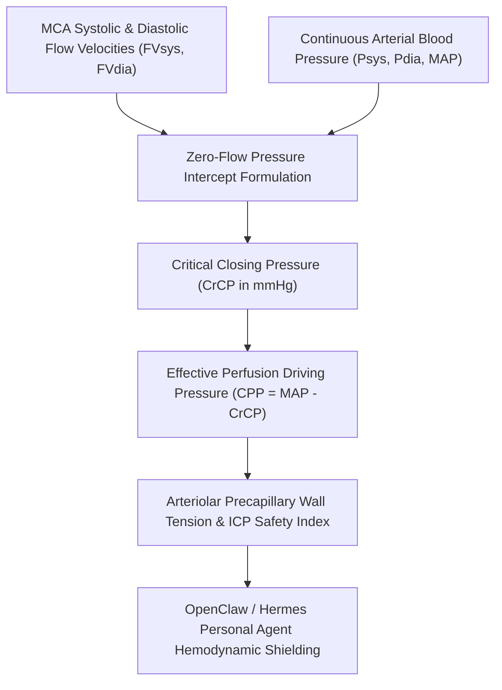

# Cerebrovascular Critical Closing Pressure (CrCP) Skill

[](LICENSE)
[](https://www.python.org/)
[](requirements.txt)
[](mcp_server.py)
[](SKILL.md)

Zero-dependency sovereign personal agent skill for non-invasive evaluation of Cerebrovascular Critical Closing Pressure (CrCP), effective cerebral perfusion pressure (CPP), and precapillary arteriolar wall tension.



## Features
- **Deterministic Math**: Pure Python standard library implementation with zero external dependencies.
- **Cerebrovascular Hemodynamic Standards**: Formulates zero-flow pressure intercept, effective cerebral perfusion pressure, and arteriolar wall tension ratios.
- **Intracranial Pressure Transmission & Hypoperfusion Shield**: Early detection of compromised effective perfusion pressure and excessive microvascular tone.
- **Model Context Protocol (MCP)**: Native JSON-RPC tool integration for LLMs and autonomous agents.

## Quickstart

```python
from client import CerebralCriticalClosingPressureClient

client = CerebralCriticalClosingPressureClient()
result = client.evaluate_crcp(
    mean_arterial_pressure_mmhg=93.0,
    systolic_bp_mmhg=120.0,
    diastolic_bp_mmhg=80.0,
    mean_flow_velocity_cm_s=62.0,
    systolic_flow_velocity_cm_s=94.0,
    diastolic_flow_velocity_cm_s=44.0
)
print("Critical Closing Pressure:", result["critical_closing_pressure_mmhg"], "mmHg")
print("Effective CPP:", result["effective_cerebral_perfusion_pressure_mmhg"], "mmHg")
print("Safety Score:", result["cerebral_safety_score"])
print("Classification:", result["classification"])
```

## License
Apache-2.0
